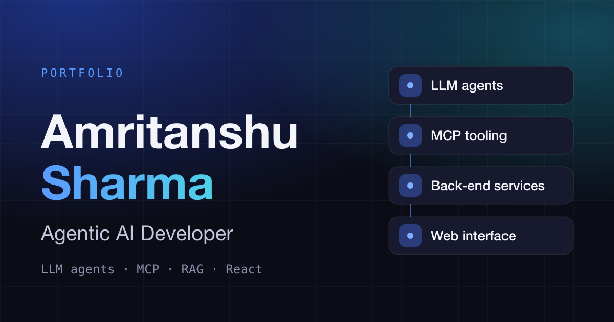

<h1 align="center">Amritanshu Sharma</h1>

<b>Agentic AI Developer</b> &nbsp;·&nbsp; LLM agents &nbsp;·&nbsp; MCP &nbsp;·&nbsp; RAG &nbsp;·&nbsp; Full stack

  

  <a href="https://amritanshu-sharma.netlify.app/">Portfolio</a> &nbsp;·&nbsp;
  <a href="https://amritanshu-sharma.netlify.app/#resume">Resume</a> &nbsp;·&nbsp;
  <a href="https://www.linkedin.com/in/amritanshu3011/">LinkedIn</a> &nbsp;·&nbsp;
  <a href="mailto:amritanshu3011@gmail.com">Email</a>

---

I build AI-powered scientific platforms at **Aganitha Cognitive Solutions** in Hyderabad, India: LLM agents, Model Context Protocol (MCP) tooling and RAG assistants, along with the FastAPI services and React interfaces that make them usable by scientists. Before moving into agentic AI, I built genomics visualization and analysis applications with research teams.

## What I work with

|                                     |                                                                                       |
| ----------------------------------- | ------------------------------------------------------------------------------------- |
| **Agentic AI and GenAI**            | LLM agents, Model Context Protocol (MCP), RAG, LangChain, Claude Code, Gemini and Claude APIs, Pinecone |
| **Backend and databases**           | Python, FastAPI, Node.js, Express, PostgreSQL, Drizzle ORM, MongoDB                   |
| **Frontend**                        | React, TypeScript, Tailwind CSS, React Query, shadcn/ui                               |
| **Scientific data and visualization** | Deck.gl, D3.js, Apache ECharts, ReactFlow, Scanpy, Squidpy                          |
| **Tools**                           | Docker, Git, GitHub                                                                   |

## Selected projects

- **[Summariii](https://github.com/therivalkiller/Summariii)**: a SaaS-ready RAG platform for chatting with and summarizing PDFs using semantic search, with Gemini and Claude support. [Live demo](https://summariii.vercel.app/)
- **[Generative AI Chatbot](https://app-genaichatbot.streamlit.app/)**: a multi-session LLM chatbot built with LangChain and the Groq API, with persistent chat history.
- **[markpdf-cli](https://pypi.org/project/markpdf-cli/)**: a command-line tool that turns Markdown into print-ready PDFs, published on PyPI.
- **[PhotoGallery](https://github.com/therivalkiller/photo-gallery-frontend)**: a full-stack photo sharing platform with real-time collaboration.

More about my work, experience and background is on my [portfolio](https://amritanshu-sharma.netlify.app/).

## Education

Integrated M.Tech in Information Technology, ABV-IIITM Gwalior (2019 to 2024). Qualified GATE 2023.
